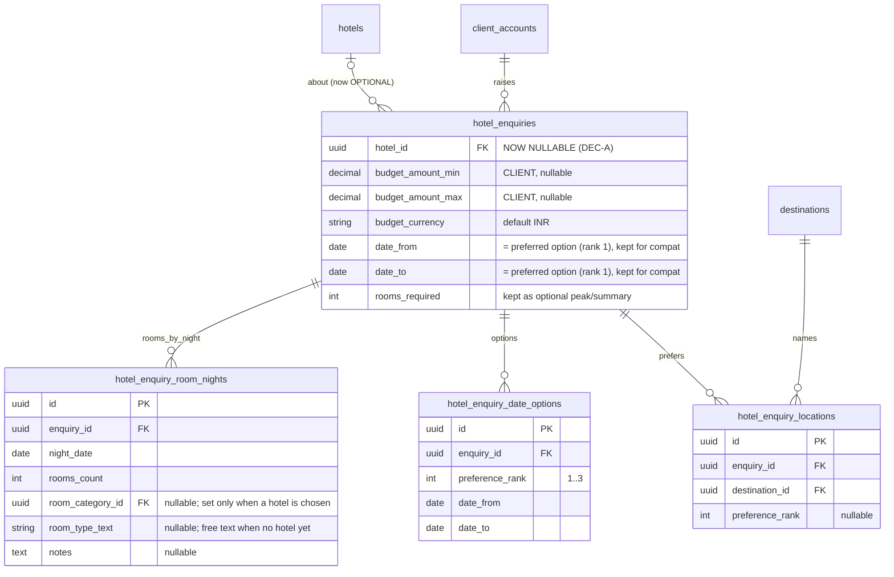

# Hotel booking inquiry — enriched intake

**Status:** draft plan, version 0.1, 26 November 2026. One developer with Claude Code.
**Scope:** enrich the client "request hotel assistance" enquiry (CP-07, Module D) with an estimated budget, a preferred-location checklist, three ranked date options, and a per-night room breakdown that spans the day before and the day after a multi-day wedding.
**Branch:** `claude/hotel-booking-inquiry-flow-15c719`.

---

## 1. Why

Today a client can only ask for help *from one specific hotel's page*: the enquiry is bound to a single `hotel_id`, a single date range, a single guest estimate and one optional rooms count. A wedding client is usually shopping — they have a budget, a short list of places, a couple of possible weekends, and a multi-day programme whose guests arrive the night before and leave the night after. The current intake cannot capture any of that, so the team re-gathers it by phone and re-keys it.

This plan turns the enquiry into a **booking brief** that still handles today's "this exact hotel" case, and adds the four fields the client asked for.

### Decisions taken this session (to be recorded as D-records from the main checkout)

- **DEC-A — the hotel becomes optional.** One form serves both cases: a client who has a hotel names it (today's behaviour, unchanged); a client who does not leaves it blank and ticks preferred locations instead. A brief must name **either a hotel or at least one preferred location** — never neither. This is the only shape that can deliver the location checklist, and it subsumes the "attach a hotel later" case without a second form.
- **DEC-B — rooms are captured per night.** A row per night across the full window (day-before → day-after), each with a room count and an optional room type. It is the only shape that lets the pre-night and post-night differ from the main nights (the point the client raised), and it is the same shape as the contracted `room_blocks` (Module K), so nothing is re-keyed when a booking is held. "Pre / main / post buckets" is the documented fallback if the per-night grid proves too heavy for clients.

> Recording note: this session runs in a worktree, where `new_decision.py` mis-numbers (the worktree vault is empty — see `ampm-recording-convention`). Create the two D-records from the **main** checkout at wrap-up.

---

## 2. Current state (audit)

The CP-07 path is consistent end to end and bound to one hotel:

| Layer | File | Today |
|---|---|---|
| Contract | `packages/core/src/schemas/consultancy.ts` → `hotelEnquiryCreateRequest` | 8 fields: `hotelId` (required), `dateFrom`/`dateTo`, `datesFlexible`, `guestEstimate`, `roomsRequired` (one nullable int), `functionsSummary`, `contactPreference`, `notesClient` |
| Model | `apps/api/prisma/schema.prisma` → `HotelEnquiry` (~L2019) | mirrors the contract 1:1; `hotel_id` NOT NULL, a plain cross-module column (no Prisma relation) |
| Service | `apps/api/src/modules/consultancy/enquiries-client.service.ts` | `requireHotelInReach(hotelReach, hotelId)`; **one open enquiry per account+hotel** (`findOpenForAccountHotel` + partial unique index `20261104063033_hotel_enquiry_open_unique`); demo prospects routed to Sales |
| Repository | `…/enquiries.repository.ts` | `ENQUIRY_SELECT`, `EnquiryWriteData`, idempotency helpers |
| Staff | `…/enquiries.{controller,service,view}.ts`; staff view in `consultancy.ts` | queue/detail key on `hotelName`; one response model per audience |
| Client UI | `apps/mobile/src/features/consultancy/new-request.form.ts` (+ `new-request-form.tsx`, `use-new-request.ts`, `new-request-screen.tsx`) | opened from a hotel page; validates dates, guests, optional whole-number rooms |

**Gap summary**

| Ask | Verdict |
|---|---|
| Estimated budget | Net-new. No budget on the enquiry (budget lives only in post-booking `budget_lines`, Module G). Additive, low risk. |
| Preferred location + checklist | Architectural. Reuse Module C `destinations` (first-class; Hotels belong to one), but `hotel_id` must go nullable and the reach-check / idempotency adapt. |
| 3 date preferences | Net-new child table of ranked options. |
| Day-0 / day-4 rooms | Net-new child table of per-night rooms across the full window. |

Precedent worth noting: the CRM `Lead` (`apps/api/prisma/schema.prisma` ~L782) already captures intake preferences (a single `destination_id`/`destination_text`, `tentative_date_from`/`to`, `guest_estimate`, `requirements`, `contact_preference`). The brief is the subscribed-client, multi-valued version of the same idea — so this is enriching an established pattern, not inventing one.

---

## 3. Target data model (expand-and-contract)

All changes are **additive or nullable** — no destructive migration, no backfill of existing rows.

Rules baked in:

- **`hotel_enquiries.hotel_id` → nullable.** The partial unique index `(account_id, hotel_id) WHERE status <> 'closed' AND deleted_at IS NULL` is **unchanged**: NULL `hotel_id` rows are distinct in a unique index, so briefs never collide, while hotel-set enquiries keep the one-open-per-hotel guard. No index migration.
- **Budget = CLIENT class**, stored as an optional min/max range in INR. It is the client's *own stated figure*, never an AMPM cost or margin, so it is **not** RESTRICTED-FINANCE and needs no internal counterpart. A single value is expressed as min = max (or just one side filled).
- **`date_from`/`date_to` stay on the row** as the preferred option (rank 1), written in sync with `hotel_enquiry_date_options`. This keeps every existing read (staff queue, views, the room-night window) working; a later contract slice may collapse them if wanted.
- **`rooms_required` stays** as an optional peak/summary count; the per-night detail lives in `hotel_enquiry_room_nights`.
- **Room nights** reference `hotel_room_categories` via nullable `room_category_id` when a hotel is known, else `room_type_text` free text — one shape that feeds `room_blocks` (Module K) later.
- Standard columns on every new table (`created_at/by`, `updated_at/by`, `deleted_at`); FKs indexed; composite/partial indexes per `.claude/rules/data.md`. Update `docs/data-model.md` §6 and regenerate `field-matrix` in the same task as the schema change (`python3 docs/tools/field_matrix_build.py`).

---

## 4. Contract changes (`packages/core`)

Contract-first (`.claude/rules/api.md`): one Zod schema, three consumers.

`hotelEnquiryCreateRequest` (new shape):

- `hotelId` → `uuid.nullable().default(null)`.
- `preferredLocationIds: z.array(uuid).max(10).default([])` — destination ids.
- `budgetAmountMin` / `budgetAmountMax` — nullable non-negative; `budgetCurrency` default `"INR"`.
- `dateOptions: z.array({ dateFrom, dateTo }).min(1).max(3)` — ranked by array order; replaces top-level `dateFrom`/`dateTo` (server maps option 1 → the row columns).
- `roomNights: z.array({ nightDate, roomsCount, roomCategoryId?/roomTypeText?, notes? }).max(31).default([])`.
- keep `guestEstimate`, `functionsSummary`, `contactPreference`, `notesClient`, `roomsRequired` (optional).
- **Cross-field refinements:** `hotelId` set **or** `preferredLocationIds` non-empty (never neither); each option `dateTo >= dateFrom`; `budgetAmountMax >= budgetAmountMin` when both present; `roomsCount >= 1`.

New view schemas added to the client and staff detail views: `hotelEnquiryDateOptionView`, `hotelEnquiryLocationView` (destination id + name, CLIENT), `hotelEnquiryRoomNightView`; budget fields added to `enquiryClientFields` so they flow to **both** audiences (budget is CLIENT). Staff queue view gains a `locationNames` fallback for when `hotelName` is null.

---

## 5. API changes

- **Controller** (`enquiries-client.controller.ts`) — unchanged wiring; validates the widened schema.
- **Service** (`enquiries-client.service.ts`):
  - Reach/selectability split: if `hotelId` present → `requireHotelInReach` (today); if location-only → validate every `preferredLocationId` is a published, non-deleted destination within the client's reach (re-checked server-side, never trusted from the client).
  - Idempotency: run `findOpenForAccountHotel` **only when `hotelId` is set**. Location-only briefs are distinct requirements and are not de-duplicated.
  - Demo prospects: still routed to Sales with no enquiry, regardless of the new fields (unchanged P-7 / AC-03.4 behaviour).
  - Create child rows (locations, date options, room nights) inside the same `$transaction` as the enquiry + the `submitted` event.
- **Repository** (`enquiries.repository.ts`): extend `EnquiryWriteData`/`ENQUIRY_SELECT`; add child-table writes and a `include`/secondary fetch for the detail views. Keep the client paths scoped to the caller's own account; keep `deletedAt: null` on every query.
- **Staff** (`enquiries.{service,view,repository}.ts`): surface budget, all date options, the room-night grid, and the location list on the staff detail; the queue shows **"Venue TBD — Goa, Udaipur"** when `hotel_id` is null.
- **Typed client** (`packages/api-client`): regenerate/extend the enquiry hooks; apps never hand-write fetch.

Visibility (`.claude/rules/security.md`): budget, locations, date options and room nights are all **CLIENT** (client-entered) and appear in both client and staff views; no new RESTRICTED field; `notes_internal` untouched. Existing grants (`consultancy.enquiries.{create,update,read}`) cover the additions — no new permission key.

---

## 6. UI changes

Client form (`apps/mobile/src/features/consultancy/…`, web via Expo web export, **Peacock Night** — read `docs/design/peacock-night.md`):

- **Budget** — an optional "approximate budget" range (two amount fields, INR), using the shared money input and tokens.
- **Preferred locations** — a multi-select checklist of published destinations (reuse the Module C destination list already in `apps/mobile/src/features/hotels/`); shown when no hotel is pre-selected, optional when a hotel is.
- **Date options** — a repeatable "add another possible date" control (1–3 ranked ranges), reusing the existing date-range validation.
- **Rooms by night** — a per-night editor seeded from the chosen date window **plus one night before and one night after**, each row a room count + optional room type; an "apply to all main nights" convenience; the "pre / main / post" fallback kept in reserve.
- All four states (loading, empty, error, offline) and a11y (44×44 targets, labels, 4.5:1) per `.claude/rules/code.md`.

Staff queue/detail (`apps/mobile/src/features/consultancy-admin/…`): render "Venue TBD + locations", the budget range, the ranked date options and the room-night table; read-only.

---

## 7. Slicing, sequence and effort

Each slice is a full vertical (contract → service/repo → api-client → mobile + web → tests → `pnpm check` green) and ends in a **full API-first box redeploy** (every slice changes the contract and the schema — see `ampm-test-deployment`). Each slice is independently valuable, so priorities can stop after any of them.

| Slice | Delivers | Touches | Est. (dev-days) |
|---|---|---|---|
| **A — Budget** | estimated budget range on the enquiry | row columns, contract, both views, both UIs | 1.5–2 |
| **C — Date options** | 3 ranked date options | `hotel_enquiry_date_options`, array contract, repeatable UI | 2.5–3 |
| **D — Rooms by night** | per-night rooms incl. day-before/day-after | `hotel_enquiry_room_nights`, per-night grid (heaviest UI) | 3–4 |
| **B — Locations + optional hotel** | the checklist; `hotel_id` nullable; reach/idempotency rework; "Venue TBD" | `hotel_enquiry_locations`, service rework, staff queue | 4–5 |
| *E — Staff source & convert (follow-on, optional)* | from a brief, staff spawn per-hotel enquiries / `room_blocks` | Module D→C/K | 4–6 |

**Recommended order: A → C → D → B.** A, C and D are additive and each enriches even today's per-hotel enquiry, so they de-risk the pipeline before B flips the hotel to optional (the keystone of the "venue-finding brief"). Intake total ≈ **11–14 dev-days**; Slice E is out of intake scope and only if you want the downstream conversion.

---

## 8. Test plan (acceptance)

- A brief with **no hotel + ≥1 location + up to 3 date options + room nights (incl. day-before/day-after)** creates successfully and returns a CLIENT view carrying all of them.
- A brief with **neither hotel nor location** is rejected (422).
- `budgetMax < budgetMin`, a date option with `dateTo < dateFrom`, and a 4th date option are each rejected.
- The **per-hotel path** (hotelId set) still enforces `requireHotelInReach` **and** one-open-per-hotel idempotency (AC-26), including the concurrent double-submit.
- A **demo prospect** is still routed to Sales (no enquiry) regardless of the new fields.
- Staff queue shows "Venue TBD — <locations>" when `hotel_id` is null; staff detail shows budget, options and the room-night grid.
- Repository scoping unchanged: a client sees only their own account's enquiries; denial equals a 404.
- `pnpm check` green (lint, typecheck, Vitest for core/API, RNTL for components) + the generated authorisation suite.

---

## 9. Open questions / risks

- **Budget shape** — range (min/max) is assumed; confirm a single "approximate budget" field isn't preferred.
- **Room-night ceiling** — a 31-night cap is assumed to bound abuse; confirm the realistic maximum window.
- **Destination reach** — confirm which destinations a subscriber may choose (all published, or only those in their plan's reach) so the picker and the server agree.
- **Slice E** — whether staff converting a brief into per-hotel enquiries / room blocks is in scope now or later.
- **Price-literal scan** — keep example amounts out of code; budget labels/currency come from configuration, not literals (`.claude/rules/api.md`).
